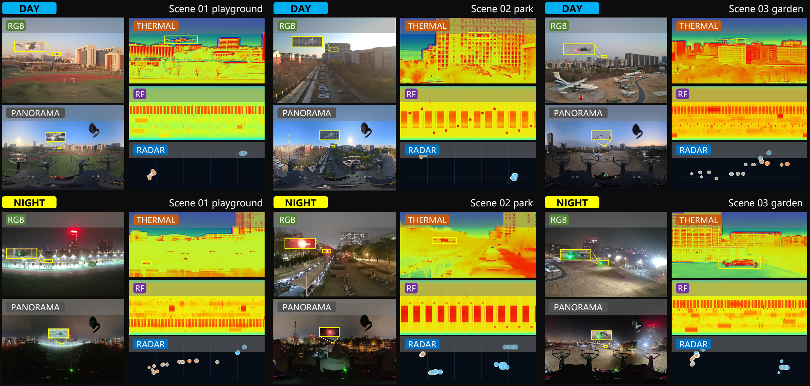

# A2A-UAV

[中文](README_zh.md) · [Dataset card](docs/DATASET_CARD.md)

A multimodal air-to-air dataset for UAV detection and identification. The release contains RGB, panoramic, thermal infrared and RF time–frequency images, radar frames where available, and sample metadata.



## Data availability

Download the preview package (`A2A-UAV_preview.tar.gz`) from either mirror.

- [Google Drive](https://drive.google.com/file/d/1oCtjoF5vfH3MsPDNQEOQ84MvRywHSUso/view?usp=sharing)
- [Baidu Netdisk](https://pan.baidu.com/s/1_P6F3z18gCyuDagdedcM2Q?pwd=A2AD) (extraction code `A2AD`)

The full dataset will be made publicly available after the paper is accepted.

The full release comprises 271 independently extractable archives, approximately 2.50 TB in total. Once available, extract the archives into the same empty directory to obtain `UAV_full_dataset_release/`.

| | Train | Validation | Test | Total |
|---|---:|---:|---:|---:|
| Samples | 61,767 | 16,468 | 27,059 | 105,294 |
| RGB and panoramic image records | 123,534 | 32,936 | 54,118 | 210,588 |
| Bounding boxes | 122,762 | 32,934 | 53,843 | 209,539 |

The data cover 15 UAV labels. Capture timestamps are omitted. Recording identifiers group related samples, while sample IDs do not encode chronology. Radar frame offsets are relative to the associated sample reference time.

## Dataset

Set `DATASET_ROOT` to the extracted `UAV_full_dataset_release` directory.

```sh
python dataset_tools/read_sample.py "$DATASET_ROOT" tr_000001
python dataset_tools/verify_release.py "$DATASET_ROOT" --quick
python dataset_tools/verify_archives.py "$ARCHIVE_DIR" "$ARCHIVE_CHECKSUM_FILE"
```

The sample reader returns paths to four PNGs, optional radar CSVs, and the sample's annotations.

### Read the five modalities

Set `DATASET_ROOT` to the extracted preview or full release, and run the reader from the repository root. The sample `tr_000505` is included in the preview.

| Modality | Reader argument | Released file |
| --- | --- | --- |
| RGB | `rgb` | `rgb.png` |
| Panorama | `panorama` | `panorama_lr.png` |
| Thermal infrared | `thermal` | `thermal.png` |
| RF time–frequency image | `rf` | `spectrum_tf.png` |
| Millimeter-wave radar | `radar` | `radar/frame_NNN.csv` |

```sh
python -m pip install Pillow
python -m dataset_tools.read_modality "$DATASET_ROOT" tr_000505 rgb
python -m dataset_tools.read_modality "$DATASET_ROOT" tr_000505 panorama
python -m dataset_tools.read_modality "$DATASET_ROOT" tr_000505 thermal
python -m dataset_tools.read_modality "$DATASET_ROOT" tr_000505 rf
python -m dataset_tools.read_modality "$DATASET_ROOT" tr_000505 radar
```

The first four commands decode the PNG and print its dimensions and pixel mode. The thermal and RF PNGs are display products. Their pixel values do not give calibrated temperature or RF power. To use the decoded image or radar points in Python, import [the reader](dataset_tools/read_modality.py).

```python
from dataset_tools.read_sample import load_sample
from dataset_tools.read_modality import read_image, read_radar

sample_dir, metadata = load_sample(DATASET_ROOT, "tr_000505")
with read_image(sample_dir, metadata, "rgb") as image:
    print(image.getpixel((0, 0)))
frames = read_radar(sample_dir, metadata)
```

The reader uses the sample's `metadata.json` when available and otherwise looks up the sample in the split manifest. The radar reader uses the Python standard library. It returns all associated frames, each with its signed offset `dt_ns` and rows in `x, y, z, intensity, velocity` order. A positive offset means the radar frame was captured after the sample reference time. A sample with no associated radar frames returns `frames: []`. A header-only CSV returns a frame with `points: []`.

Radar XYZ is in meters in the original radar sensor frame (`ti_mmwave_0` in the checked source recordings). Velocity is the signed radial velocity in m/s. The reader preserves these values. To project points onto RGB or panoramic images, use the radar-to-camera extrinsics and projection model for that camera. The published time offsets describe temporal association.

## Detection

The recorded environment used Python 3.10, PyTorch 2.1.0 with CUDA 11.8, TorchVision 0.16.0, MMDetection 3.3.0, MMCV 2.1.0, and MMEngine 0.10.7.

```sh
export A2AUAV_BENCHMARK_ROOT="$PWD/benchmark_inputs"
python detection/prepare_annotations.py --dataset-root "$DATASET_ROOT" \
  --rgb-out "$A2AUAV_BENCHMARK_ROOT/rgb/data/coco/annotations" \
  --panorama-out "$A2AUAV_BENCHMARK_ROOT/panorama/data/panorama_coco/annotations"
python detection/panorama/prepare_tiles.py --experiment-root "$A2AUAV_BENCHMARK_ROOT/panorama"
python detection/panorama/prepare_training_subsets.py --experiment-root "$A2AUAV_BENCHMARK_ROOT/panorama"
```

Use MMDetection's `tools/train.py` with the selected RGB or panorama configuration. Add `detection/panorama` to `PYTHONPATH` for panorama training. Place the initialization weights under the corresponding `pretrained/` path in the benchmark directory.

```sh
python detection/rgb/evaluate.py --benchmark-root "$A2AUAV_BENCHMARK_ROOT" \
  --config detection/rgb/configs/faster_rcnn.py --checkpoint "$RGB_CHECKPOINT" \
  --work-dir "$RGB_EVAL_DIR" --split test
python detection/panorama/evaluate.py --experiment-root "$A2AUAV_BENCHMARK_ROOT/panorama" \
  --run-name faster_rcnn --checkpoint "$PANO_CHECKPOINT" --split test_full
```

Panorama settings are 1280-pixel tiles, 1024-pixel stride, and 0.55 NMS IoU. Use `merge_predictions.py` to score saved tile predictions. For FCOS-KL, use the matching KLDet checkout, legacy MMDetection environment, and configuration in `detection/legacy_fcos_kl/`.

## RF identification

Build the RF index from the downloaded classification index and checksum inventory. Identical spectrograms share a sampling group.

```sh
python rf_identification/prepare_index.py --dataset-root "$DATASET_ROOT" --output "$RF_INDEX"
python rf_identification/prepare_cache.py --dataset-root "$DATASET_ROOT" \
  --index "$RF_INDEX" --output-dir "$RF_CACHE"
python -m torch.distributed.run --nproc_per_node=2 rf_identification/train_and_evaluate.py \
  --cohort downloaded --index "$RF_INDEX" --cache-root "$RF_CACHE" --output-dir "$RF_RUN_DIR" \
  --method efficientnet_v2_s --seed 42
```

The cache uses 1333 × 800 RGB PNGs with bilinear resizing. For evaluation with `--eval-only`, place the selected checkpoint at `best.pt` in the run directory. The default `--cohort paper` uses the archived experimental index. See `recorded_settings.json` for the recorded model settings.

The paper's benchmark metrics refer to archived experimental inputs and checkpoints. Using the downloadable dataset's split files evaluates the methods on that release.

## Citation and license

See [CITATION.cff](CITATION.cff) for citation metadata and [LICENSE.md](LICENSE.md) for the dataset license.
