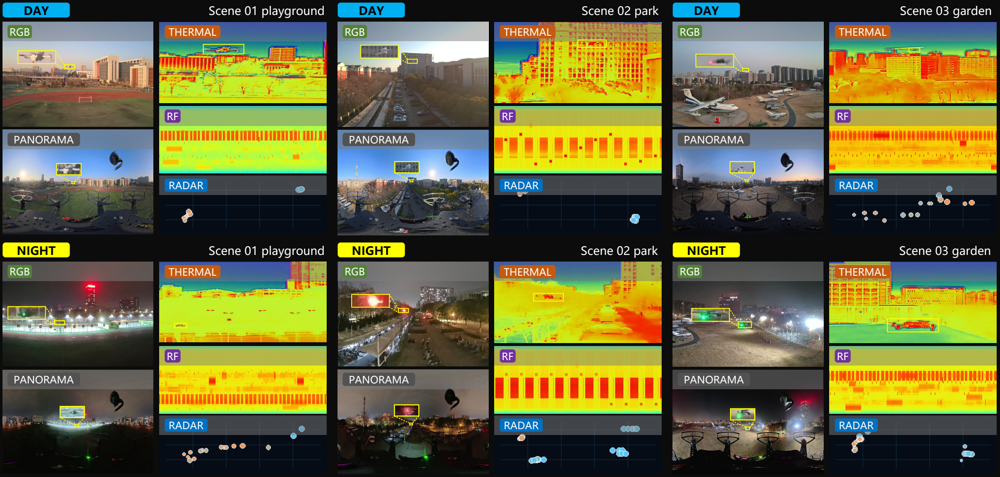

<h1 align="center">A2A-UAV</h1>
<h3 align="center">A Multimodal Air-to-Air Dataset for UAV Detection and Identification</h3>

<p align="center">
  <a href="https://arxiv.org/abs/2611.21311"></a>
  <a href="LICENSE-DATA.md"></a>
</p>

<p align="center"><strong>English</strong> | <a href="README_zh.md">简体中文</a></p>

A2A-UAV provides time-aligned RGB, panoramic, thermal infrared, RF time–frequency and millimeter-wave radar observations of 15 target UAVs of 13 commercial models, acquired by a UAV-mounted sensing platform at three outdoor scenes under daytime and nighttime conditions.

<p align="center"></p>

## Download

A 200-sample preview subset (`A2A-UAV_preview.tar.gz`) is available from either mirror.

- [Google Drive](https://drive.google.com/file/d/1oCtjoF5vfH3MsPDNQEOQ84MvRywHSUso/view?usp=sharing)
- [Baidu Netdisk](https://pan.baidu.com/s/1_P6F3z18gCyuDagdedcM2Q?pwd=A2AD) (extraction code `A2AD`)

The full dataset will be released upon acceptance of the paper. It comprises 271 independently extractable `.tar.gz` archives with a total size of approximately 2.50 TB. Extract all archives into the same directory to obtain `UAV_full_dataset_release/`. Image archives follow `A2A-UAV_images_<split>_<part>.tar.gz`; `A2A-UAV_metadata.tar.gz` contains the annotations and indexes.

The preview reader uses the 200-sample index included in `dataset_tools/preview_manifests/`. Set `DATASET_ROOT` to the extracted preview directory or full release.

```sh
export DATASET_ROOT="/path/to/A2A-UAV_preview"
```

After downloading the full release, verify its archives and extracted files.

```sh
export ARCHIVE_DIR="/path/to/downloaded/archives"
export DATASET_ROOT="/path/to/UAV_full_dataset_release"
python dataset_tools/verify_archives.py "$ARCHIVE_DIR" checksums/archives.sha256
python dataset_tools/verify_release.py "$DATASET_ROOT" --quick
```

The full-release archive checksums are in [checksums/archives.sha256](checksums/archives.sha256). The dataset card is [DATA_CARD.md](DATA_CARD.md).

## Dataset structure

The full release uses the following layout.

```text
UAV_full_dataset_release/
├── annotations/
│   └── instances_{train,val,test}.json
├── images/
│   └── {train,val,test}/<sample_id>/
│       ├── metadata.json
│       ├── rgb.png
│       ├── panorama_lr.png
│       ├── thermal.png
│       ├── spectrum_tf.png
│       └── radar/frame_NNN.csv
├── manifests/
│   └── full_{train,val,test}.jsonl
├── metadata/
│   ├── classification_index.json
│   ├── classification_index_trainable.json
│   └── recording_assignments.csv
└── reports/
    ├── build_summary.md
    └── integrity_report.json
```

| | Train | Validation | Test | Total |
| --- | ---: | ---: | ---: | ---: |
| Recordings | 68 | 15 | 26 | 109 |
| Samples | 61,767 | 16,468 | 27,059 | 105,294 |
| Bounding boxes | 122,762 | 32,934 | 53,843 | 209,539 |
| Samples with radar data | 61,737 | 16,468 | 27,058 | 105,263 |

Sample identifiers combine the split prefix `tr`, `va` or `te` with a six-digit number, for example `tr_000505`. The splits are defined at the recording level, and all samples of one canonical recording belong to the same split.

## Accessing each modality

Each sample directory `images/<split>/<sample_id>/` contains the products below. Install Pillow and NumPy, then run the readers from the repository root. The example `tr_000505` is included in the preview.

```sh
python -m pip install Pillow numpy
```

| Modality | File | Format | Reader argument |
| --- | --- | --- | --- |
| RGB | `rgb.png` | 1280 × 720, 24-bit PNG | `rgb` |
| Panorama | `panorama_lr.png` | 5760 × 2880, 24-bit PNG, equirectangular | `panorama` |
| Thermal infrared | `thermal.png` | 384 × 288 PNG | `thermal` |
| RF time–frequency | `spectrum_tf.png` | 6000 × 3600, RGBA PNG | `rf` |
| Radar | `radar/frame_NNN.csv` | One CSV per radar frame | `radar` |
| Metadata | `metadata.json` | JSON | — |

The command-line reader prints the image path, size and pixel mode, or the radar frames of a sample.

```sh
python -m dataset_tools.read_modality "$DATASET_ROOT" tr_000505 rgb
python -m dataset_tools.read_modality "$DATASET_ROOT" tr_000505 panorama
python -m dataset_tools.read_modality "$DATASET_ROOT" tr_000505 thermal
python -m dataset_tools.read_modality "$DATASET_ROOT" tr_000505 rf
python -m dataset_tools.read_modality "$DATASET_ROOT" tr_000505 radar
```

In Python, load a sample once and read its modalities.

```python
import numpy as np
from dataset_tools.read_sample import load_sample
from dataset_tools.read_modality import read_image, read_radar

DATASET_ROOT = "/path/to/A2A-UAV_preview"
sample_dir, metadata = load_sample(DATASET_ROOT, "tr_000505")
rgb = np.asarray(read_image(sample_dir, metadata, "rgb"))
panorama = np.asarray(read_image(sample_dir, metadata, "panorama"))
thermal = np.asarray(read_image(sample_dir, metadata, "thermal"))
spectrum = np.asarray(read_image(sample_dir, metadata, "rf"))
radar_frames = read_radar(sample_dir, metadata)
```

### RGB images

`rgb.png` is captured by the RGB camera of the Skydroid C12 gimbal with a field of view of 100° × 52°. The UAV bounding box is stored in `metadata["annotations"]["rgb"]`.

### Panoramic images

`panorama_lr.png` is an equirectangular frame extracted from the Insta360 X5 video with 360° coverage. The UAV bounding box is stored in `metadata["annotations"]["panorama"]`. The detection benchmark divides each panorama into 18 tiles of 1280 × 1280 pixels with a stride of 1024 pixels.

### Thermal infrared images

`thermal.png` is captured by the thermal camera of the Skydroid C12, with a spectral range of 8–14 µm and a field of view of 24.8° × 18.7°. Read the PNG in its stored pixel mode to preserve its bit depth and channel configuration. Pixel values are display values without calibrated temperatures. Thermal images have no bounding-box annotations.

### RF time–frequency images

`spectrum_tf.png` is the short-time Fourier transform of a 0.1-s IQ segment recorded by the HAROGIC NXM-60 at a center frequency of 2.42 GHz and a sampling rate of 125 MSa/s. The STFT uses a 1024-sample Hamming window, a 512-sample overlap and a 1024-point FFT. The horizontal axis spans 0 to 0.1 s, the vertical axis spans 2.3575 to 2.4825 GHz, and the jet color map represents the relative logarithmic power within each image.

Each sample is assigned the RF image with the nearest acquisition time in the same recording. Samples of the same recording may share one RF image. The UAV label is `metadata["classification_label"]`.

### Millimeter-wave radar point clouds

Radar frames are recorded by the Texas Instruments IWR1843AOPEVM with a frame period of 50 ms. Frames within ±120 ms of a sample reference time are assigned exclusively to the nearest eligible sample in the same recording. Samples with radar data have one to six frames under `radar/`.

Each CSV row is one point in `x, y, z, intensity, velocity` order. XYZ is in meters in the radar sensor frame, identified as `ti_mmwave_0` in the checked source recordings. Velocity is the signed radial velocity in m/s. The reader preserves these values.

`read_radar` returns the frame list and the signed time offset `dt_ns`, defined as radar frame time minus sample reference time. A sample without radar data returns `[]`. A header-only CSV returns a frame with `points: []`. Radar provides temporal association with the sample; pointwise radar–camera spatial registration is unavailable in this release.

To select samples with radar frames from the full-release manifest, use the following code.

```python
import json
from pathlib import Path

manifest = Path(DATASET_ROOT) / "manifests/full_train.jsonl"
with manifest.open(encoding="utf-8") as stream:
    radar_rows = [
        row for line in stream if line.strip()
        for row in [json.loads(line)] if row["radar_frames"]
    ]
```

### Sample metadata

`metadata.json` records the sample identifier, split, recording identifier, scene, illumination condition, UAV label, modality file paths, RGB and panoramic boxes, and radar frame list. `scene_001`, `scene_002` and `scene_003` denote playground, park and garden. `condition_001` and `condition_002` denote night and day. Capture timestamps are omitted, and sample numbers do not encode chronology.

`load_sample` returns a consistent metadata dictionary using per-sample metadata or a sample index. Use the example below to inspect it.

```sh
python dataset_tools/read_sample.py "$DATASET_ROOT" tr_000505
```

## Annotations and labels

RGB and panoramic boxes are provided in two formats. `metadata.json` and JSONL manifests store `[x_min, y_min, x_max, y_max]` in pixels. COCO files in `annotations/` store `[x_min, y_min, width, height]`. The `modality` field of each COCO image record distinguishes `rgb` from `panorama`. Each image contains at most one box.

| UAV model | Label |
| --- | --- |
| DJI Avata | `a1` |
| DJI Air 2S | `air2s` |
| DJI Air 3 | `air3` |
| DJI Air 3S | `air3s` |
| DJI Avata 2 | `avata2` |
| DJI Flip | `flip` |
| DJI Mavic 2 Pro | `mavic2pro` |
| DJI Mavic 4 Pro | `mavic4pro` |
| DJI Mini 3 Pro | `mini3pro` |
| DJI Mini 4 Pro, unit 1 | `mini4pro_csq` |
| DJI Mini 4 Pro, unit 2 | `mini4pro_xm` |
| DJI Mini 4 Pro, unit 3 | `mini4pro_z` |
| DJI Mini 5 Pro | `mini5pro` |
| DJI Neo | `neo1` |
| DJI Neo 2 | `neo2` |

The three Mini 4 Pro labels distinguish different aircraft of the same model.

## Benchmarks

### Detection

The main detection environment uses Python 3.10, PyTorch 2.1.0 with CUDA 11.8, TorchVision 0.16.0, MMDetection 3.3.0, MMCV 2.1.0 and MMEngine 0.10.7.

Prepare the RGB and panorama annotations from the full released splits, then generate panorama tiles and training subsets.

```sh
export A2AUAV_BENCHMARK_ROOT="$PWD/benchmark_inputs"
python detection/prepare_annotations.py --dataset-root "$DATASET_ROOT" \
  --rgb-out "$A2AUAV_BENCHMARK_ROOT/rgb/data/coco/annotations" \
  --panorama-out "$A2AUAV_BENCHMARK_ROOT/panorama/data/panorama_coco/annotations"
python detection/panorama/prepare_tiles.py --experiment-root "$A2AUAV_BENCHMARK_ROOT/panorama"
python detection/panorama/prepare_training_subsets.py --experiment-root "$A2AUAV_BENCHMARK_ROOT/panorama"
```

Download the [torchvision ResNet-50 ImageNet weights](https://download.pytorch.org/models/resnet50-11ad3fa6.pth) to both pretrained directories.

```sh
mkdir -p "$A2AUAV_BENCHMARK_ROOT/rgb/pretrained" "$A2AUAV_BENCHMARK_ROOT/panorama/pretrained"
curl -L --fail https://download.pytorch.org/models/resnet50-11ad3fa6.pth \
  -o "$A2AUAV_BENCHMARK_ROOT/rgb/pretrained/resnet50-11ad3fa6.pth"
cp "$A2AUAV_BENCHMARK_ROOT/rgb/pretrained/resnet50-11ad3fa6.pth" \
  "$A2AUAV_BENCHMARK_ROOT/panorama/pretrained/resnet50-11ad3fa6.pth"
```

Set `MMDET_ROOT` to the MMDetection 3.3.0 checkout. The following examples train Faster R-CNN on three GPUs for RGB and two GPUs for panorama.

```sh
export MMDET_ROOT="/path/to/mmdetection"
export PYTHONPATH="$PWD/detection/panorama${PYTHONPATH:+:$PYTHONPATH}"
python -m torch.distributed.run --nproc_per_node=3 "$MMDET_ROOT/tools/train.py" \
  detection/rgb/configs/faster_rcnn.py --launcher pytorch \
  --work-dir "$A2AUAV_BENCHMARK_ROOT/rgb/runs/faster_rcnn"
python -m torch.distributed.run --nproc_per_node=2 "$MMDET_ROOT/tools/train.py" \
  detection/panorama/configs/faster_rcnn.py --launcher pytorch \
  --work-dir "$A2AUAV_BENCHMARK_ROOT/panorama/runs/faster_rcnn"
```

The other main-environment configuration names are `dynamic_rcnn`, `cascade_rcnn`, `sparse_rcnn`, `dino` and `ddq`. The existing configurations define training length, negative-tile sampling, validation monitoring and stopping criteria.

FCOS-KL uses [KLDet](https://github.com/TinyOD/mmdet-kldet) commit `79caa41f16c84be8b9a6567002f51c2cad976f8d`, Python 3.8.20, PyTorch 1.10.2+cu113, MMCV 1.4.0 and MMDetection 2.13.0. Its [environment and adapter instructions](detection/legacy_fcos_kl/README.md) apply to the RGB and panorama configurations.

Evaluate a validation-selected checkpoint on the released test split of 27,059 samples. RGB and panorama evaluation each cover one image per test sample.

```sh
python detection/rgb/evaluate.py --benchmark-root "$A2AUAV_BENCHMARK_ROOT" \
  --config detection/rgb/configs/faster_rcnn.py --checkpoint "$RGB_CHECKPOINT" \
  --work-dir "$RGB_EVAL_DIR" --split test
python detection/panorama/evaluate.py --experiment-root "$A2AUAV_BENCHMARK_ROOT/panorama" \
  --run-name faster_rcnn --checkpoint "$PANO_CHECKPOINT" --split test_full
```

Panorama evaluation uses 0.55 NMS IoU. To merge saved tile predictions, run the following command.

```sh
python detection/panorama/merge_predictions.py \
  --experiment-root "$A2AUAV_BENCHMARK_ROOT/panorama" \
  --run-name faster_rcnn --split test_full \
  --results-jsonl "$PANO_PREDICTIONS_JSONL"
```

### RF identification

The commands below train and evaluate RF identification models on the released splits.

Build the RF index from the released classification index and checksum inventory. Identical spectrograms share a sampling group.

```sh
export RF_INDEX="$PWD/rf_index.json"
export RF_CACHE="$PWD/rf_cache"
export RF_RUN_DIR="$PWD/runs/rf/efficientnet_v2_s"
python rf_identification/prepare_index.py --dataset-root "$DATASET_ROOT" --output "$RF_INDEX"
python rf_identification/prepare_cache.py --dataset-root "$DATASET_ROOT" \
  --index "$RF_INDEX" --output-dir "$RF_CACHE"
python -m torch.distributed.run --nproc_per_node=2 rf_identification/train_and_evaluate.py \
  --index "$RF_INDEX" --cache-root "$RF_CACHE" --output-dir "$RF_RUN_DIR" \
  --method efficientnet_v2_s --seed 42
```

The cache contains 1333 × 800 RGB PNGs resized with bilinear interpolation. Recording-PK sampling uses six samples per GPU and an effective batch of 12 with two GPUs. Checkpoints are selected by validation macro-F1. Methods are `resnet18`, `resnet50`, `efficientnet_v2_s`, `convnext_tiny`, `swin_t` and `mobilenet_v3_large`.

For evaluation with `--eval-only`, place the selected checkpoint at `best.pt` in the run directory.

## Citation and license

```bibtex
@misc{liang2026a2auavmultimodalairtoairdataset,
  title={A2A-UAV: A Multimodal Air-to-Air Dataset for UAV Detection and Identification},
  author={Hongtao Liang and Yiyao Wan and Kezhi Zhu and Jiayi Zhang and Zequn Jiang and Ziyu Zhou and Jiahuan Ji and Fuhui Zhou and Qihui Wu},
  year={2026},
  eprint={2611.21311},
  archivePrefix={arXiv},
  primaryClass={cs.CV},
  url={https://arxiv.org/abs/2611.21311},
}
```

Machine-readable citation metadata is available in [CITATION.cff](CITATION.cff). Code is licensed under [Apache-2.0](LICENSE), and dataset files under [CC BY 4.0](LICENSE-DATA.md).
