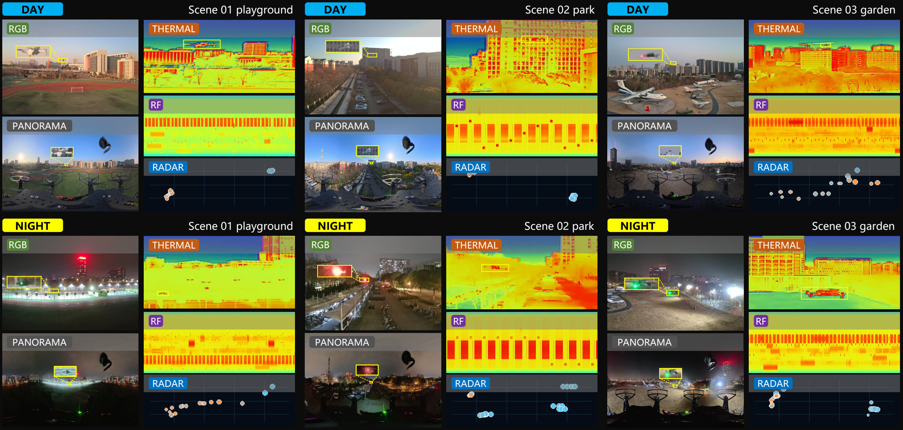

<h1 align="center">A2A-UAV</h1>

<h3 align="center">面向空对空无人机检测与识别的多模态数据集</h3>

<p align="center">
  RGB &nbsp;·&nbsp; 全景图像 &nbsp;·&nbsp; 热红外图像 &nbsp;·&nbsp; 射频时频图 &nbsp;·&nbsp; 毫米波雷达
</p>

<p align="center">
  <a href="https://arxiv.org/abs/2611.21311"></a>
  <a href="#数据获取"></a>
  <a href="LICENSE.md"></a>
  <a href="dataset_tools/read_modality.py"></a>
</p>

<p align="center">
  <a href="README.md">English</a> &nbsp;·&nbsp; <strong>简体中文</strong>
  &nbsp;|&nbsp; <a href="https://arxiv.org/abs/2611.21311">论文</a>
  &nbsp;|&nbsp; <a href="docs/DATASET_CARD.md">数据卡</a>
  &nbsp;|&nbsp; <a href="#引用与许可">引用</a>
</p>

<table align="center">
  <tr>
    <td align="center" width="25%"><h3>105,294</h3>多模态样本</td>
    <td align="center" width="25%"><h3>15</h3>无人机标签</td>
    <td align="center" width="25%"><h3>109</h3>采集记录组</td>
    <td align="center" width="25%"><h3>3</h3>场景 · 昼夜覆盖</td>
  </tr>
</table>

<p align="center">
  
</p>

<table align="center">
  <tr>
    <td width="33%" valign="top">
      <h3><a href="#数据获取">下载预览包 ↗</a></h3>
      浏览数据集中的 200 个样本。<br><br>
      <a href="https://drive.google.com/file/d/1oCtjoF5vfH3MsPDNQEOQ84MvRywHSUso/view?usp=sharing">Google Drive</a> &nbsp;·&nbsp;
      <a href="https://pan.baidu.com/s/1_P6F3z18gCyuDagdedcM2Q?pwd=A2AD">百度网盘</a>
    </td>
    <td width="33%" valign="top">
      <h3><a href="#五种模态的读取">读取数据 →</a></h3>
      一个入口读取五种模态。<br><br>
      <a href="#五种模态的读取">Python 示例</a> &nbsp;·&nbsp;
      <a href="docs/DATASET_CARD.md">数据格式</a>
    </td>
    <td width="33%" valign="top">
      <h3><a href="README.md#detection">运行基线 →</a></h3>
      无人机检测与射频识别。<br><br>
      <a href="README.md#detection">检测实验</a> &nbsp;·&nbsp;
      <a href="README.md#rf-identification">射频识别</a>
    </td>
  </tr>
</table>

## 数据获取

预览包 `A2A-UAV_preview.tar.gz` 可通过以下任一入口下载。

- [Google Drive](https://drive.google.com/file/d/1oCtjoF5vfH3MsPDNQEOQ84MvRywHSUso/view?usp=sharing)
- [百度网盘](https://pan.baidu.com/s/1_P6F3z18gCyuDagdedcM2Q?pwd=A2AD)（提取码 `A2AD`）

完整数据集将在论文录用后公开。

完整发布包由 271 个可独立解压的归档组成，总计约 2.50 TB。数据公开后，将归档解压到同一个空目录，即可得到 `UAV_full_dataset_release/`。

数据共 105,294 个样本，覆盖 15 个无人机标签。训练、验证和测试集分别为 61,767、16,468、27,059 个样本。公开数据省略了采集时间戳。记录标识用于分组，样本编号不表示时间顺序。雷达帧偏移以其对应样本的参考时刻为基准。

## 五种模态的读取

将 `DATASET_ROOT` 设为解压后的预览包或完整数据集目录，然后在仓库根目录运行。示例样本 `tr_000505` 可在预览包中找到。

| 模态 | 读取参数 | 发布文件 |
| --- | --- | --- |
| RGB | `rgb` | `rgb.png` |
| 全景图像 | `panorama` | `panorama_lr.png` |
| 热红外图像 | `thermal` | `thermal.png` |
| 射频时频图 | `rf` | `spectrum_tf.png` |
| 毫米波雷达 | `radar` | `radar/frame_NNN.csv` |

```sh
python -m pip install Pillow
python -m dataset_tools.read_modality "$DATASET_ROOT" tr_000505 rgb
python -m dataset_tools.read_modality "$DATASET_ROOT" tr_000505 panorama
python -m dataset_tools.read_modality "$DATASET_ROOT" tr_000505 thermal
python -m dataset_tools.read_modality "$DATASET_ROOT" tr_000505 rf
python -m dataset_tools.read_modality "$DATASET_ROOT" tr_000505 radar
```

前四条读取命令解码 PNG，并输出尺寸和像素模式。发布版热红外和射频时频图为显示图像，像素值无法直接换算为标定后的温度或射频功率。在 Python 中可以导入[读取脚本](dataset_tools/read_modality.py)，直接获取像素和雷达点。

```python
from dataset_tools.read_sample import load_sample
from dataset_tools.read_modality import read_image, read_radar

sample_dir, metadata = load_sample(DATASET_ROOT, "tr_000505")
with read_image(sample_dir, metadata, "rgb") as image:
    print(image.getpixel((0, 0)))
frames = read_radar(sample_dir, metadata)
```

脚本优先读取样本的 `metadata.json`，缺少该文件时使用对应划分的 JSONL 清单。雷达读取只依赖 Python 标准库。脚本返回全部关联帧及其有符号的时间偏移 `dt_ns`，点数据按 `x, y, z, intensity, velocity` 排列。正偏移表示雷达帧晚于样本参考时刻。无关联帧的样本返回 `frames: []`，仅有表头的 CSV 保留该帧并返回 `points: []`。

XYZ 保留雷达传感器坐标，单位为米。经核对的源记录使用 `ti_mmwave_0` 坐标帧。速度为有符号的径向速度，单位为 m/s。脚本保留这些数值。若需将雷达点投到 RGB 或全景图像上，请使用对应相机的雷达–相机外参与投影模型。发布的帧偏移描述的是时间关联。

## 代码

- [样本读取与归档校验](README.md#dataset)
- [标注转换、全景切片与检测评估](README.md#detection)
- [RF 索引、输入准备与识别实验](README.md#rf-identification)

## 引用与许可

如果您在研究中使用 A2A-UAV，请引用[数据集论文](https://arxiv.org/abs/2611.21311)。

```bibtex
@misc{liang2026a2auavmultimodalairtoairdataset,
  title={A2A-UAV: A Multimodal Air-to-Air Dataset for UAV Detection and Identification},
  author={Hongtao Liang and Yiyao Wan and Kezhi Zhu and Jiayi Zhang and Zequn Jiang and Ziyu Zhou and Jiahuan Ji and Fuhui Zhou and Qihui Wu},
  year={2026},
  eprint={2611.21311},
  archivePrefix={arXiv},
  primaryClass={cs.CV},
  url={https://arxiv.org/abs/2611.21311},
}
```

引用元数据见 [CITATION.cff](CITATION.cff)，数据集许可见 [LICENSE.md](LICENSE.md)。
